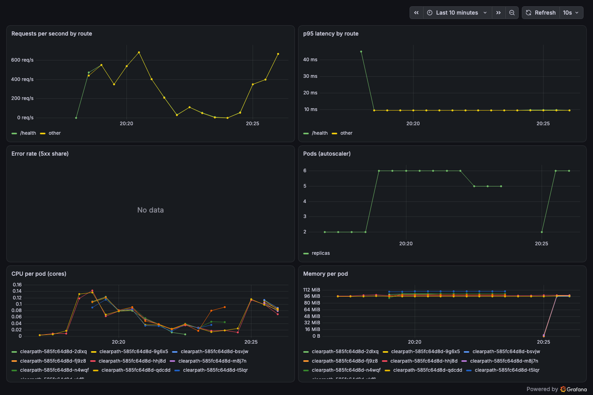

# Running ClearPath on Kubernetes (local kind cluster)

The same container image that runs on Cloud Run, deployed with plain manifests: a namespace, a ConfigMap,
a two-replica Deployment with readiness and liveness probes, resource limits and a non-root security
context, and a ClusterIP Service. It runs in offline demo mode, so no API keys are needed.

```bash
kind create cluster --name clearpath
docker build -t clearpath:local .
kind load docker-image clearpath:local --name clearpath
kubectl apply -f k8s/clearpath.yaml
kubectl -n clearpath rollout status deploy/clearpath
kubectl -n clearpath port-forward svc/clearpath 8080:80   # then open http://localhost:8080
```

Rolling update with no downtime (maxUnavailable 0):

```bash
kubectl -n clearpath rollout restart deploy/clearpath
kubectl -n clearpath rollout status deploy/clearpath
```

## Helm chart: autoscaling, ingress and monitoring

`charts/clearpath` packages the same deployment with a HorizontalPodAutoscaler (2 to 6 pods on CPU),
a PodDisruptionBudget, an nginx Ingress (`clearpath.local`), and Prometheus metrics on a separate port
(9100, turned on by `PROMETHEUS_PORT`), with a ServiceMonitor and a Grafana dashboard for
kube-prometheus-stack. CI installs the chart on a kind cluster on every push (`k8s` job).

```bash
helm repo add metrics-server https://kubernetes-sigs.github.io/metrics-server/
helm repo add ingress-nginx https://kubernetes.github.io/ingress-nginx
helm repo add prometheus-community https://prometheus-community.github.io/helm-charts
helm install metrics-server metrics-server/metrics-server -n kube-system --set 'args={--kubelet-insecure-tls}'
helm install ingress-nginx ingress-nginx/ingress-nginx -n ingress-nginx --create-namespace --set controller.admissionWebhooks.enabled=false
helm install monitoring prometheus-community/kube-prometheus-stack -n monitoring --create-namespace -f charts/monitoring/values.yaml
helm install clearpath charts/clearpath -n clearpath --create-namespace \
  --set metrics.serviceMonitor.enabled=true --set metrics.dashboard.enabled=true
```

Load test (the autoscaler adds pods once average CPU passes 60% of the request):

```bash
kubectl -n clearpath run load --image=busybox:1.36 --restart=Never -- /bin/sh -c \
  'for i in $(seq 1 24); do (while true; do wget -q -O- --header "Host: localhost" http://clearpath/health >/dev/null; done) & done; sleep 240'
kubectl -n clearpath get hpa -w
```

Grafana: `kubectl -n monitoring port-forward svc/monitoring-grafana 3000:80`, user `admin`, password from
`kubectl -n monitoring get secret monitoring-grafana -o jsonpath='{.data.admin-password}' | base64 -d`.



**Go gateway.** With `gateway.enabled` (the default) the Ingress sends traffic to a Go reverse proxy
(`services/gateway`) that rate-limits each client and exports its own metrics, then forwards to the app.
Build its image and load it before installing: `docker build -t clearpath-gateway:local services/gateway &&
kind load docker-image clearpath-gateway:local --name clearpath`. Details in `services/gateway/README.md`.

Measured on a 2-CPU, 4 GB local kind cluster: under about 600 requests per second the autoscaler went from
2 to 6 pods in under a minute, p95 latency stayed around 10 ms, and it scaled back down after the load stopped.
